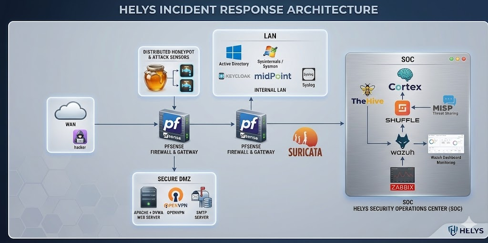
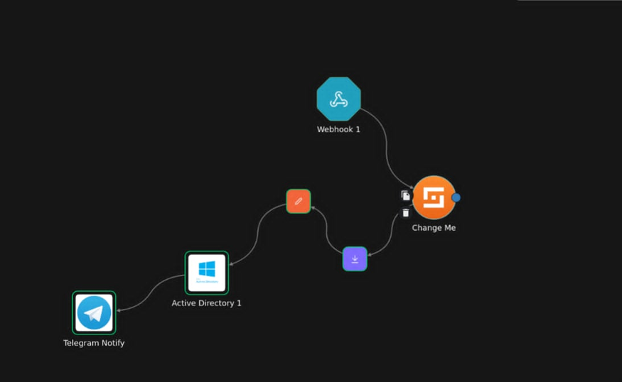
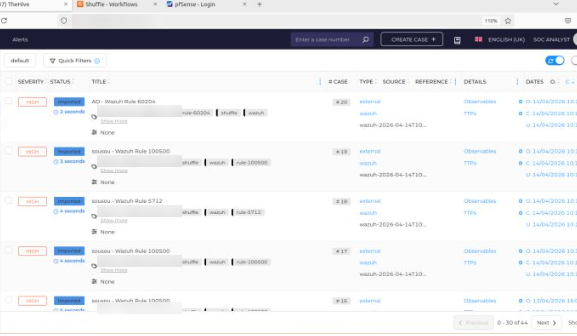
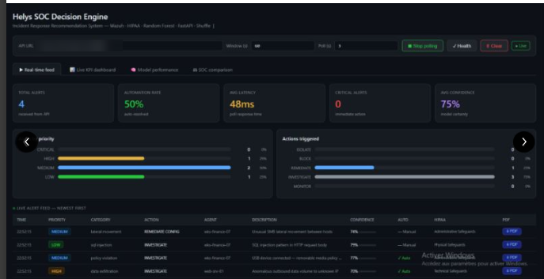

# HELYS – AI-Assisted SOC & Incident Response Platform for Healthcare

> *Securing Care, Defending Trust.*

HELYS is a Security Operations Center (SOC) built in a virtualized lab to protect a simulated hospital infrastructure. It covers the full chain: **network segmentation → detection → correlation → automated response → case management → threat intelligence**, using open-source tools, with a machine-learning layer to help prioritise alerts.

Integrated engineering project at **ESPRIT** (School of Engineering, Tunisia), academic year 2025-2026, built by a team of seven students.

> 🇫🇷 **En bref** : HELYS est un SOC open source pour le secteur de la santé, déployé en laboratoire. Il détecte les attaques avec Wazuh, Suricata et Sysmon, automatise la réponse avec Shuffle (blocage d'IP, désactivation de compte, création de cas dans TheHive) et enrichit les indicateurs avec Cortex et MISP. Une couche IA (Random Forest) aide à prioriser les alertes pour limiter les faux positifs.



---

## Why healthcare?

A cyberattack on a hospital does not only compromise systems: it can delay care, expose patient data and force staff back to paper records. Healthcare is also bound by strict rules (GDPR, HIPAA, ISO/IEC 27001) that require access control, audit trails and traceability. The goal of HELYS is to detect attacks early and respond in minutes rather than hours, with an affordable open-source stack.

---

## Architecture

The lab is split into isolated zones behind **two pfSense firewalls**:

| Zone | Components | Role |
|---|---|---|
| **WAN** | Attacker machine | Simulated external threats |
| **DMZ** | Web server (Nginx, DVWA test app), OpenVPN, SMTP, SSH/SFTP | Patient-facing services |
| **Honeynet** | Cowrie SSH honeypot, attack sensors | Attract and study attackers |
| **LAN** | Active Directory, Windows workstations (Sysmon), Keycloak, MidPoint | Hospital internal network and identities |
| **SOC** | Wazuh, Suricata, TheHive, Cortex, Shuffle, MISP, Graylog, Zabbix | Monitoring and response |

More details: [docs/architecture.md](docs/architecture.md)

### Technology stack

| Function | Tools |
|---|---|
| SIEM / XDR | Wazuh (agents on DMZ, LAN and honeypot hosts) |
| Network IDS | Suricata (EVE JSON logs forwarded to Wazuh) |
| Host monitoring | Sysmon (SwiftOnSecurity-based configuration), Wazuh agents, FIM |
| SOAR | Shuffle (Docker) |
| Case management | TheHive |
| Enrichment & CTI | Cortex (VirusTotal analyzer), MISP |
| Log aggregation | Graylog (DMZ logs) |
| Perimeter | pfSense ×2 |
| Identity | Active Directory, Keycloak, MidPoint |
| Deception | Cowrie SSH honeypot |
| AI layer | Python, scikit-learn (Random Forest), FastAPI prototype |

---

## Detection & response scenarios

| Scenario | Detection | Automated response |
|---|---|---|
| **SSH / AD brute force** (Hydra) | Wazuh rules on auth logs and Windows Event 4625 (MITRE T1110) | Attacker IP blocked (Wazuh active response / pfSense), TheHive case, team notified |
| **Privilege escalation** in Active Directory | Events 4728 / 4732 (user added to a privileged group) | User removed from the group, account disabled, case created |
| **Credential dumping** (Mimikatz) | Sysmon Event 1 and Event 10 (LSASS access), custom rule 100004 (T1003) | Process killed, host isolated, case with observables (IP, hash, hostname) |
| **Web attacks** on the DMZ | Custom rules for SQL injection and directory traversal (T1190) | Alert and case |
| **Patient data tampering** | File Integrity Monitoring on the patient data directory (T1565) | Critical alert, HIPAA-tagged |

End-to-end flow:

```
Attack → Suricata / Sysmon / auth logs → Wazuh (rules + MITRE mapping)
       → Shuffle (webhook) → Cortex enrichment (VirusTotal)
       → Response (block IP / kill process / disable account)
       → TheHive case + notification (Telegram)
```

Step-by-step write-ups: [docs/scenarios.md](docs/scenarios.md) · Custom Wazuh rules: [detection/wazuh/local_rules.xml](detection/wazuh/local_rules.xml)

<p align="center">
  
  
</p>

---

## AI layer

The AI layer aims to reduce **alert fatigue**: ranking alerts so analysts deal with real threats first.

- **Network attack classifier**: a Random Forest trained on the public **CIC-IDS2017** dataset to classify network flows (benign, DDoS, web attack, other attacks). Notebook: [ai/cicids2017_random_forest.ipynb](ai/cicids2017_random_forest.ipynb)
- **SOC Decision Engine (prototype)**: a FastAPI service that reads Wazuh alerts, scores them and recommends an action (investigate, remediate, block, isolate), shown in a live dashboard.



Details and limits of the model: [docs/ai-alert-classification.md](docs/ai-alert-classification.md)

---

## My contributions

*This was a team project. My main contributions:*

- **Network and host detection**: deployment of Suricata (IDS), Sysmon on Windows endpoints and the Active Directory lab (OU structure, audit and lockout GPOs), all feeding Wazuh.
- **Detection engineering**: custom Wazuh rules for healthcare use cases, mapped to MITRE ATT&CK.
- **Incident response automation**: Wazuh → Shuffle → TheHive workflows and alert notifications.
- **AI**: data preparation and Random Forest classification on CIC-IDS2017.

---

## Compliance mapping

| Requirement | How HELYS addresses it |
|---|---|
| **HIPAA** (protected health information) | FIM on patient data, access control via AD/Keycloak, audit logging |
| **GDPR** | Detection of unauthorised access, traceability of incidents in TheHive |
| **ISO/IEC 27001** | Network segmentation, role-based access, centralised logging and incident management |

---

## Limitations and next steps

**Limitations (honestly):**
- Virtualized lab (VMware), not a production hospital network.
- Some Shuffle workflows remained at proof-of-concept level.
- Suricata runs in IDS mode only (no inline blocking).
- The ML model was evaluated on a public dataset, not yet on HELYS traffic.

**Next steps:**
- Test the model on alerts generated by the lab itself and measure false positives.
- Move the stack to containers / Kubernetes and add runtime detection (Falco).
- Write detection rules in **Sigma** to keep them independent from the SIEM.

---

## Repository content

```
├── README.md
├── docs/
│   ├── architecture.md
│   ├── scenarios.md
│   └── ai-alert-classification.md
├── detection/wazuh/local_rules.xml
├── ai/cicids2017_random_forest.ipynb
└── images/
```

Configurations, credentials, internal IP addresses and API keys are intentionally excluded.

---

**Author:** Mariem Othmani, cybersecurity engineering student at ESPRIT (SOC, incident response, AI security)
