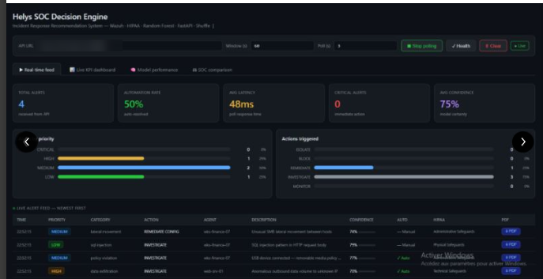

# AI layer – attack classification

## Goal

A SOC that raises too many alerts ends up being ignored (*alert fatigue*). The AI layer of HELYS helps analysts by classifying network activity and recommending an action, so that the most dangerous alerts are handled first.

## Network attack classifier (CIC-IDS2017)

Notebook: [../ai/cicids2017_random_forest.ipynb](../ai/cicids2017_random_forest.ipynb)

**Dataset:** CIC-IDS2017 (Canadian Institute for Cybersecurity), network flows described by about 77 features (packet sizes, durations, flags…). The CSV files are not included in this repository; place them in `ai/data/MachineLearningCVE/` to run the notebook.

**Preparation**
1. Merge the daily CSV files (about 2.1 million flows).
2. Remove infinite values, empty values and duplicates.
3. Rebalance: the dataset is about 86 % benign traffic, so benign flows were down-sampled to 100,000.
4. Group the labels into categories (benign, DDoS, web attack, other attacks).

**Model**
- `RandomForestClassifier` (100 trees, `class_weight="balanced"` to compensate for rare classes).
- 80/20 stratified train/test split, features scaled with `StandardScaler` fitted on the training set only.
- Outputs: classification report, confusion matrix, top 15 most important features.

**Results and limits**
- Accuracy is very high on the test set (above 99 %), but CIC-IDS2017 is known to give optimistic results: the attacks are easy to separate in this lab-generated traffic.
- Very rare classes (Infiltration, SQL injection: only a handful of samples) cannot be learned reliably.
- The real test is to run the model on HELYS's own alerts and measure the false-positive rate, which is the next step.

## SOC Decision Engine (prototype)

A FastAPI service polls Wazuh alerts, scores them with the model and recommends an action: **monitor, investigate, remediate, block or isolate**. The dashboard shows:
- the live alert feed with priority, category, recommended action and confidence;
- KPIs: number of alerts, automation rate, latency, critical alerts;
- the mapping of each alert to HIPAA safeguards.

Low-confidence or critical actions still require analyst validation: the engine recommends, the analyst decides.

