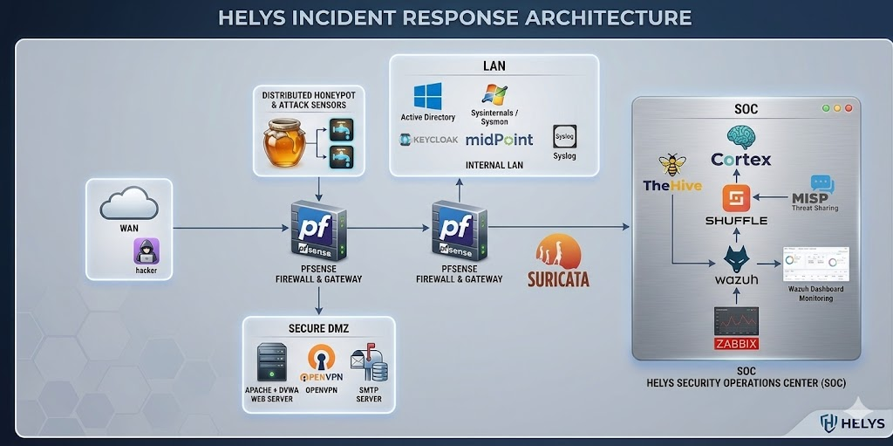

# Architecture



## Network zones

HELYS uses a **dual-firewall design** with two pfSense instances.

**pfSense #1 – perimeter firewall**
- Interfaces: WAN, LINK (toward pfSense #2), DMZ, Honeypot.
- Stateful filtering, NAT, DHCP/DNS for the DMZ and honeypot zones.
- First line of defence between the Internet and every internal zone.

**pfSense #2 – internal firewall**
- Interfaces: LINK, LAN, SOC.
- Segmentation between users and the SOC: the SOC can reach the LAN for monitoring, but the LAN cannot reach SOC management interfaces.
- Unsolicited inbound traffic on LINK is blocked; firewall logs are forwarded to the SOC.

| Zone | Hosts | Purpose |
|---|---|---|
| DMZ | Web server (Nginx, DVWA test app), SSH/SFTP, OpenVPN, SMTP | Services exposed to patients and partners |
| Honeynet | Cowrie SSH honeypot (Docker), attack sensors | Deception and attacker behaviour analysis |
| LAN | Domain controllers (Windows Server 2022), Windows workstations with Sysmon, Keycloak, MidPoint | Hospital users and identities |
| SOC | Wazuh manager and dashboard, TheHive, Cortex, Shuffle, MISP, Graylog, Zabbix | Detection, response and investigation |

## Data sources

| Source | Collected by | What it provides |
|---|---|---|
| Linux auth logs (SSH) | Wazuh agent | Brute-force detection |
| Windows Security events (4624, 4625, 4648, 4720, 4732, 4768, 4769, 4771, 4776) | Wazuh agent on AD | Logons, Kerberos activity, group changes |
| Sysmon (Events 1, 3, 7, 8, 10, 11, 12/13, 22) | Wazuh agent | Process creation, network connections, LSASS access, persistence |
| Suricata EVE JSON (alert, flow, http, dns, tls) | Wazuh | Scans, C2 patterns, lateral movement, exfiltration |
| Nginx access logs | Wazuh agent, Graylog | Web attacks on the DMZ |
| Cowrie JSON logs | Wazuh | Honeypot logins and attacker commands |
| File Integrity Monitoring | Wazuh syscheck | Changes to patient data and system files |
| pfSense syslog | SOC | Firewall events |

## Suricata detection coverage

| Category | Technique | MITRE ATT&CK |
|---|---|---|
| Network scanning | Nmap / Masscan activity | T1046 |
| Brute force | Repeated SMB / RDP authentication failures | T1110 |
| Command & control | Known C2 callback patterns (ET Open) | T1071 |
| DNS tunnelling | Long or high-frequency DNS queries | T1071.004 |
| Lateral movement | SMBv1 / EternalBlue patterns | T1021.002 |
| Exfiltration | Large outbound transfers on unusual ports | T1041 |

## Active Directory hardening

- OUs: Servers, Workstations, Users, Admins, ServiceAccounts.
- GPOs: audit policy (logon and Kerberos events), password policy (12 characters minimum, complexity), account lockout (5 failures), AppLocker on workstations, server hardening (SMBv1 and NTLMv1 disabled).
- Privileged access: Domain Admins restricted to dedicated admin workstations, fine-grained password policy for privileged accounts, KRBTGT password reset twice at setup, AdminSDHolder monitored.

## Response chain

```
Wazuh alert ──webhook──▶ Shuffle ──▶ Cortex (VirusTotal enrichment)
                            │
                            ├──▶ Response: pfSense block / Wazuh active response / AD action
                            ├──▶ TheHive case with observables (IP, hash, hostname, user)
                            ├──▶ MISP update (IOC sharing)
                            └──▶ Notification (Telegram)
```
