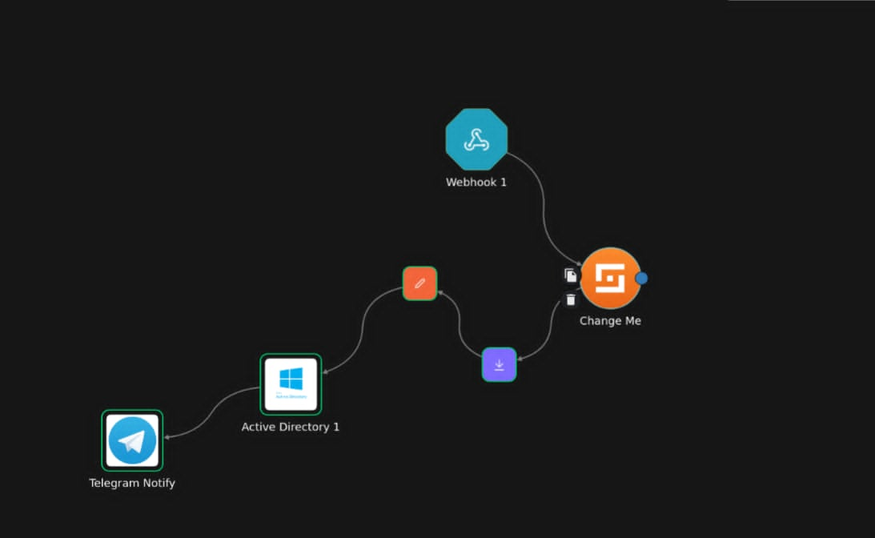
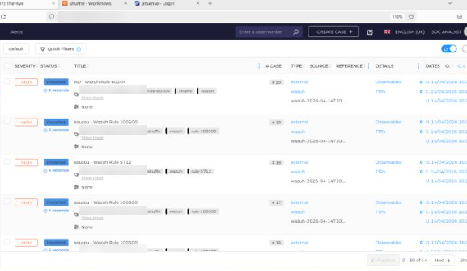

# Detection & response scenarios

All scenarios were run in the isolated lab with controlled tools.

---

## 1. Brute force (SSH and Active Directory)

**Attack:** Hydra dictionary attack against SSH on a Linux host and against RDP/SMB on the domain (MITRE **T1110**).

**Detection (Wazuh)**
- SSH: built-in `sshd` rules on `/var/log/auth.log`; the brute-force rule fires when failures exceed a threshold within a time window (level 10+).
- Active Directory: Windows Event **4625** (failed logon); alert when more than 5 failures occur within one minute.

**Response**
- Wazuh active response `firewall-drop`: the attacker IP is blocked with iptables for 600 seconds, then automatically released (both actions are logged).
- Shuffle receives the alert, enriches the IP through Cortex (VirusTotal), checks whether it is internal or external, creates a TheHive case and notifies the team.
- Optionally, the targeted account is temporarily disabled.

**Variant – honeypot:** the same attack against the Cowrie honeypot in the DMZ is logged (logins, commands typed) and forwarded to Wazuh, then turned into a TheHive case, without any real system being exposed.

---

## 2. Privilege escalation in Active Directory

**Attack:** a compromised domain user adds itself to a privileged group (Domain Admins / Administrators).

**Detection (Wazuh)**
- Windows Events **4728** and **4732** (member added to a security group).
- Critical alert when the group is privileged.

**Response (Shuffle)**
- Check whether the change was approved (policy and time window).
- Remove the user from the group, force a password reset or disable the account.
- Create an investigation case in TheHive and alert SOC administrators.

---

## 3. Credential dumping and malware (Mimikatz)

**Attack:** Mimikatz is dropped on a Windows workstation to dump LSASS credentials and move laterally (MITRE **T1003**).

**Detection**
- Sysmon **Event 1** (process creation): custom rule `100004` matches `mimikatz.exe` (level 15).
- Sysmon **Event 10** (process access to `lsass.exe`).
- File hash checked against VirusTotal through Cortex.

**Response**
- Wazuh active response kills the process.
- The host is isolated with a firewall rule.
- TheHive case with observables: IP, hash, hostname.

---

## 4. Web attacks on the DMZ

**Attack:** SQL injection and directory traversal against the Nginx web server (MITRE **T1190**).

**Detection:** custom rules `300001` (directory traversal, `../` or `etc/passwd`) and `300002` (SQL injection characters in the URL).

---

## 5. Patient data protection

- File Integrity Monitoring on `/opt/patient_data`: any change raises a **critical** alert (rule `100002`, MITRE **T1565**, tagged HIPAA).
- Rule `100100` flags mass access to electronic health records in the application logs.

---

## Alert triage

TheHive receives Wazuh alerts through Shuffle, with tags for the source (Sysmon, Wazuh), the rule ID and the observables, so the analyst can open a case directly from the alert.

